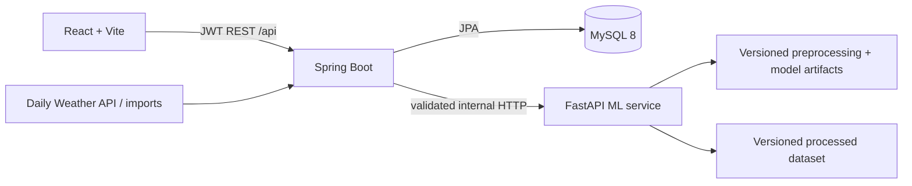
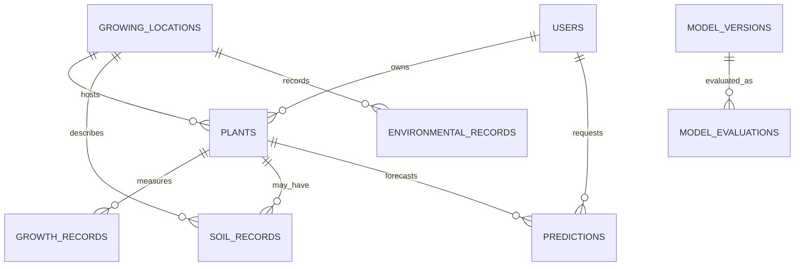

# Architecture

The React app never calls FastAPI directly. Spring Boot is the authorization boundary and persists all prediction inputs, model metadata, outputs, and explanations. The ML service rejects missing artifacts rather than generating a fallback forecast.

## Core relationships

The primary research target is `FUTURE_HEIGHT` in cm. A training example at origin *t* targets the first measurement in the configured tolerance near *t + horizon*; examples without a valid target are excluded rather than invented.
